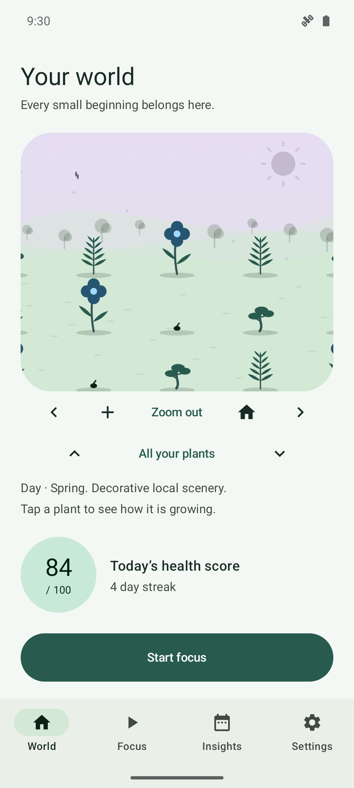
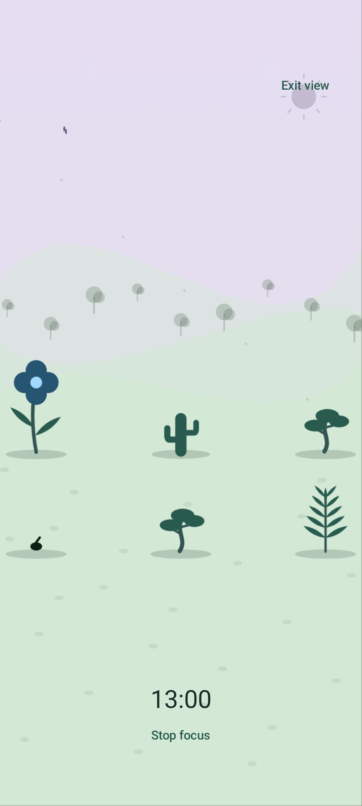
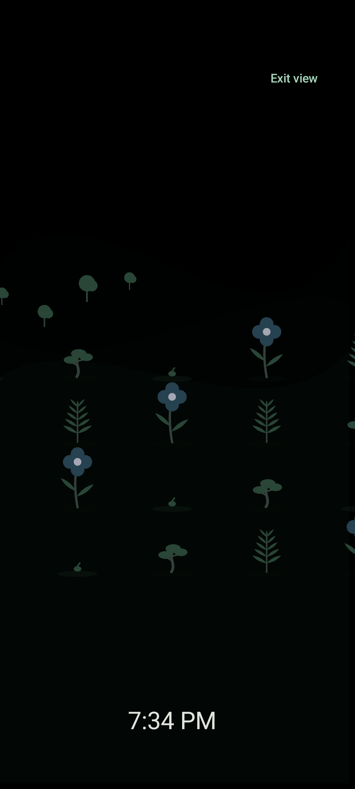

# ScreenGarden

**Make room for yourself. Watch something grow.**

A free, open-source Android garden for calmer screen habits. Focus on one thing,
set gentle goals, and grow plants that can always recover. Everything works offline.

[](https://github.com/34rns/ScreenGarden/actions/workflows/ci.yml)
[](LICENSE)

Android 8.0+ · No accounts · No ads · No tracking · No internet permission

[Website and screenshots](https://34rns.github.io/ScreenGarden/) ·
[GitHub releases](https://github.com/34rns/ScreenGarden/releases) ·
[Release protocol](docs/RELEASING.md)

## A little space to grow

| World | Fullscreen Focus | Desk |
| --- | --- | --- |
|  |  |  |

These are emulator screenshots with **fake debug-only demo data**. No personal
phone data appears in the [full screenshot gallery](docs/GALLERY.md).

## What you can do

- Grow a lasting world, pan and zoom through older plants, and use the full plant list.
- Focus fullscreen in your own world with a persistent timer and gentle rewards.
- Enable a dim Desk view with a shifting clock, reduced motion and low-power controls.
- Set screen-time, pickup and app goals; choose quiet hours and optional reminders.
- See day/week/month charts, local reflections, streaks, compassion days and badges.
- Choose light, dark or AMOLED themes, curated accents, seasons and low-power visuals.
- Add a garden widget, use a focus Quick Settings tile, or preview a live wallpaper.
- Save a garden picture or export/import validated local JSON backups through Android's picker.
- Use English or the bundled Spanish sample; optionally enable package-only focus blocking.

Optional blocking is **off by default**. Its restricted accessibility service never
reads screen content or stores observed events. Only your edited block/allow lists
are saved. See [how optional blocking works](docs/FOCUS_BLOCKING.md).

## Install

Distribution is through [GitHub Releases](https://github.com/34rns/ScreenGarden/releases)
only. [Get the latest signed APK](https://github.com/34rns/ScreenGarden/releases/latest),
open it on Android, and allow installation from the app you used to download it. Turn that
installation permission off afterward if you prefer.

You can also build the debug app using the steps below. Debug builds have a
separate application ID and do not update the release app.
Keep your exported backup somewhere private before uninstalling or moving devices.

## Privacy you can check

The merged manifest has **no INTERNET permission** and automatic backup is disabled.
There are no analytics, advertising, tracking or cloud SDKs. Room and DataStore keep
your measurements, garden and preferences on the device. No account is required.

Nothing is shared automatically. Pictures and unencrypted JSON backups leave the
app only when you choose a destination in Android's picker. A backup can include
private app usage; share it carefully. Permissions and special app access remain
optional and can be revoked in Android settings.

## Build and test

Open the project in Android Studio with JDK 17, Android SDK/platform 35 and
build-tools 35.0.0. Dependencies are pinned in the version catalog; the first build
needs free Maven downloads. The installed app works offline.

From the repository root in PowerShell:

```powershell
.\gradlew.bat ktlintCheck --no-build-cache
.\gradlew.bat :app:testDebugUnitTest
.\gradlew.bat :app:lintDebug
.\gradlew.bat :app:assembleDebug
.\gradlew.bat :app:installDebug
```

On macOS/Linux use `./gradlew`. The debug APK is under
`app/build/outputs/apk/debug/`. With the dedicated emulator running, execute
`:app:connectedDebugAndroidTest` for the integration/migration suite. Tests manage
their own artificial state; never publish screenshots of real usage.

## Architecture

One Activity hosts Compose/Material 3 screens and navigation. ViewModels expose
immutable state through Flow; pure Kotlin domain rules handle health, growth,
focus, habits and summaries. Android adapters sit behind interfaces. Manual
`AppContainer` injection connects Room, Preferences DataStore and WorkManager.

Day boundaries come from one `LocalDay` helper, with UTC epoch timestamps and DST
tests. Room schemas v1–v7 are immutable; every upgrade needs a migration and test.
Built-in [plant packs](docs/PLANT_PACKS.md) contain original, validated offline art.
One deterministic world renderer serves World, Focus, Desk, widgets, wallpaper and
snapshots. See the [World, Focus and Desk guide](docs/WORLD.md).

## Verification and limits

The quality pass has **384 passing JVM tests and 20 passing Android 15 integration
tests**, zero lint errors and six documented warnings. Fake-data layouts were
reviewed in light/dark/AMOLED, Spanish, RTL, small-phone, tablet and landscape modes,
including larger text. See the [quality report](docs/QUALITY.md).

OEM usage-event gaps remain unknown, rather than invented scores. Reminders/widgets
are approximate and focus completion can be delayed during sleep. Physical-device
battery behavior, actual reboot/process-death recovery, low-end performance, the
complete current API 26 UI, and native-speaker Spanish review remain unverified.

## Frequently asked questions

**Why no internet permission?** It makes offline behavior and the privacy promise
checkable at the platform boundary. Weather and reflections are generated locally.

**Why Usage access?** Android requires it to read app foreground durations and screen
events. That evidence shapes your local history and garden score. You can skip it
and still grow plants through focus.

**Can a plant die?** Plants may wilt gradually, but never disappear permanently.
Quiet days and focus sessions can restore their health.

**Why is history missing?** Android exposes limited recent event history and some
devices omit events. A new installation cannot reconstruct older measured days.
Previously stored local history stays available.

**Does it block apps?** Gentle mode does not. The optional accessibility aid can
redirect chosen apps during focus and always leaves escape routes available.
It is not a security boundary.

**Does it need a store or paid account?** No. Source, builds, hosting and GitHub
downloads are free. There is no F-Droid or Google Play release plan.

## Roadmap and contributing

P01–P33 are complete, including the signed GitHub release and screenshot site.
P35 adds the shared world, fullscreen Focus and Desk views; see the [changelog](CHANGELOG.md).
Next improvements focus on device verification,
translation review and accessibility feedback. See [the prompt roadmap](docs/PROMPTS.md)
and [contribution guide](CONTRIBUTING.md), including small starter tasks.

Read the [code of conduct](CODE_OF_CONDUCT.md). Report sensitive issues through
the [security guide](SECURITY.md), without attaching private backups.

## License

Code: **GPL-3.0-or-later**, [LICENSE](LICENSE).
Original art and built-in plant packs: **CC BY-SA 4.0**, [art attribution](ART_LICENSE.md).
Libraries retain their [third-party notices](THIRD_PARTY_NOTICES.md), also bundled
in the APK. Source is public alongside every binary release.

## Support

[Buy me a coffee](https://www.supportkori.com/rnsofficial)
