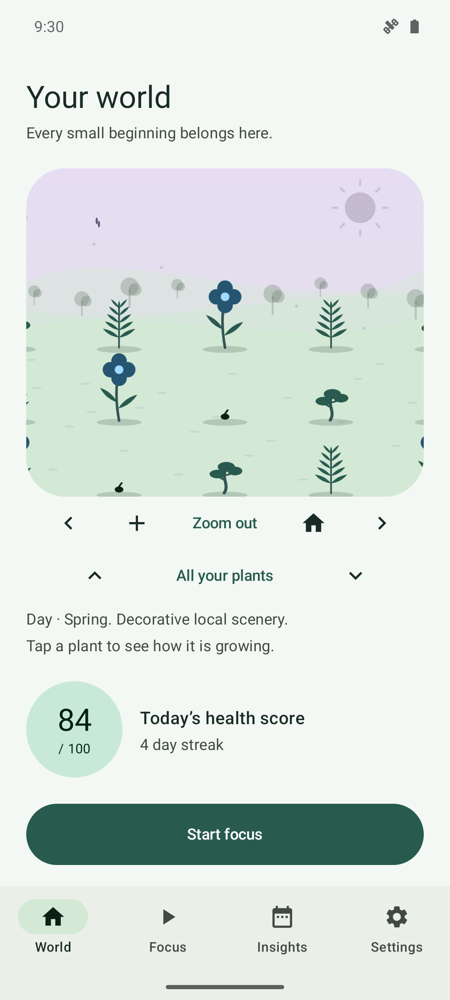
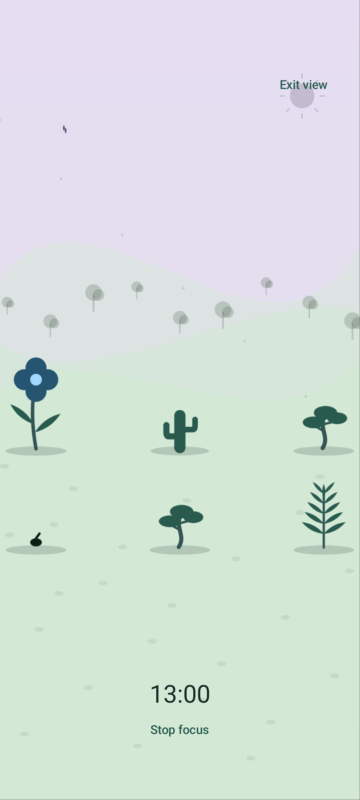
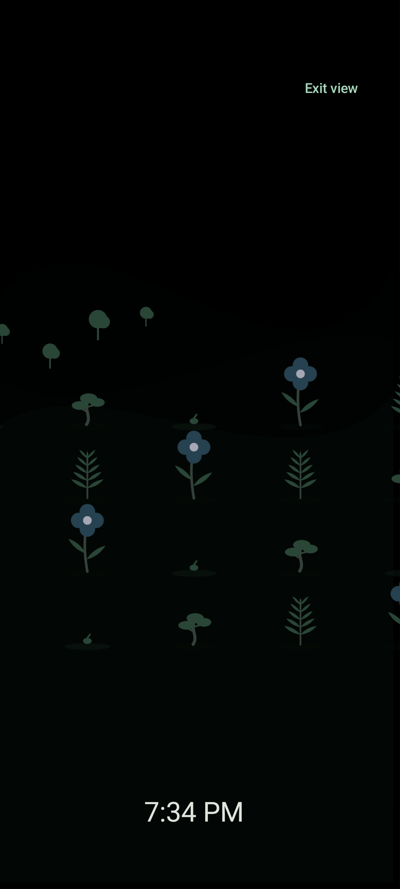

# ScreenGarden 1.1.0 — A world of your own

A free, offline Android meadow that grows with you. Android 8.0 or later.

- **World:** pan, pinch to zoom, or use camera buttons to explore all your plants.
  A good completed day can add another seed; older plantings remain.
- **Fullscreen Focus:** your own world, a small timer and a growing plant preview.
  Exit view keeps the timer running; Stop focus ends it explicitly.
- **Desk:** opt-in dim scenery with an optional clock, slow pixel shifting and
  a charging offer. Decorative motion runs at most 12 fps and stops when hidden,
  in battery saver, with reduced animations or with low-power visuals.
- A shared renderer and new original meadow, green/dusk colors and rounded shapes.
  Widgets, wallpaper and snapshots reuse the same drawing code.
- Tested backup v3 upgrades from v1/v2. Room remains v7; no new permission or library.

Download **ScreenGarden-v1.1.0.apk**. The signing certificate is retained from
v0.1.0, allowing an ordinary update. Keep private backups before changing devices.
Usage access and notifications remain optional. The app has no internet permission,
accounts, advertising, tracking or paid dependency.

The release runs all four quality gates, production lint, immutable-schema and
privacy checks, signing verification and alignment checks. SHA256SUMS.txt,
signature.txt and corresponding source accompany the APK.

Verification details are in the [quality report](https://github.com/34rns/ScreenGarden/blob/v1.1.0/docs/QUALITY.md).
Real-device battery use, thermal behavior, OLED lifetime, OEM reliability, actual
reboot/process death and the complete current API26 UI remain unverified.
Pixel shifting cannot guarantee protection from burn-in. Reminders and widgets
remain approximate, and sleep can delay focus completion.

## A look inside

Fresh Android-emulator screenshots use fake debug-only demo data.

| World | Focus | Desk |
| --- | --- | --- |
|  |  |  |

[Website](https://34rns.github.io/ScreenGarden/) ·
[World guide](https://github.com/34rns/ScreenGarden/blob/v1.1.0/docs/WORLD.md) ·
[Full gallery](https://github.com/34rns/ScreenGarden/blob/v1.1.0/docs/GALLERY.md)

Code: GPL-3.0-or-later. Original artwork: CC BY-SA 4.0. No external art or fonts added.
